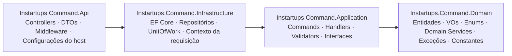
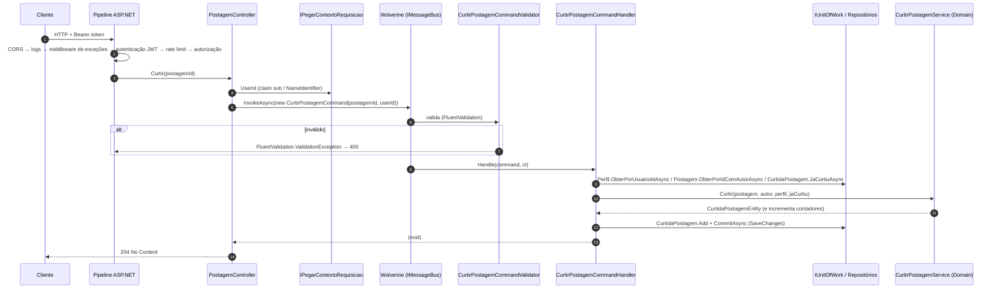

# Arquitetura

[← Índice](README.md)

A API segue uma arquitetura em camadas inspirada em Clean Architecture/DDD, cobrindo apenas o lado **Command** do CQRS: todo endpoint recebe uma intenção de mudança, a transforma em um *command*, valida, executa as regras de domínio e persiste.

## Camadas e dependências



Cada projeto referencia **apenas** o projeto à sua direita (a referência é transitiva: a Api enxerga todas as camadas).

| Camada | Responsabilidade | Pastas principais |
| --- | --- | --- |
| **Api** | Expor HTTP, converter DTO → command, configurar autenticação, autorização, CORS, rate limit, OpenAPI, logs e tratar exceções. | `Controllers/`, `DTOs/`, `Configurations/`, `Middleware/`, `Extensions/`, `wwwroot/` (assets do Scalar) |
| **Application** | Orquestrar casos de uso: um command, um validator e um handler por caso de uso. Define as interfaces de persistência. | `UseCases/<CasoDeUso>/`, `Common/` (commands e validators compartilhados), `Interfaces/` |
| **Domain** | Regras de negócio puras, sem dependência de framework. | `Entities/`, `ValueObjects/`, `Enums/`, `Services/`, `Exceptions/`, `Constants/` |
| **Infrastructure** | Implementar persistência (EF Core + PostgreSQL/PostGIS) e serviços técnicos. | `Persistence/` (DbContext, `Configurations/`, `Repositories/`, `Migrations/`), `Service/`, `Configurations/DependencyInjection.cs` |

## Fluxo de uma requisição

Exemplo: `POST /api/instartups/command/postagem/{postagemId}/curtir`.



Pontos importantes:

1. **O controller não tem regra de negócio.** Ele só lê o `UserId` do token, monta o command (via `dto.ToCommand(...)` ou `new XCommand(...)`) e chama `MessageBus.InvokeAsync`.
2. **Validação acontece no Wolverine**, antes do handler (`opt.UseFluentValidation()`). Os validators são descobertos automaticamente no assembly da Application.
3. **Regras de negócio ficam no domínio**: métodos das entidades (`PostagemEntity.AdicionarMidiaPostagem`, `PerfilEntity.Desativar`…) e *domain services* estáticos quando a regra envolve mais de uma entidade (`CurtirPostagemService`, `SeguirPerfilService`, `DesativarPostagemService`, `ReativarPostagemService`).
4. **Erros são exceções.** Handlers e domínio lançam exceções tipadas; o `ExceptionsMiddleware` converte cada uma no status HTTP correspondente. Veja [Validações e erros](VALIDACOES-E-ERROS.md).
5. **Uma transação por requisição**: o handler faz uma única chamada a `IUnitOfWork.CommitAsync` (`SaveChangesAsync`) ao final.

## Pipeline HTTP (`Program.cs`)

Registro de serviços:

```csharp
builder.AddSerilogConfig().AddWolverineConfig();
builder.Services.AddInfrastructureDependencyInjection(builder.Configuration);
builder.Services
    .AddControllersConfig()      // filtros globais, resposta de ModelState inválido
    .AddLowerCaseConfig()        // URLs e query strings em minúsculas
    .AddAuthenticationConfig()   // JWT Bearer RS256
    .AddAuthorizationConfig()    // política "Admin"
    .AddCorsConfigurations()     // política "FRONTEND"
    .AddRateLimiterConfig()      // token bucket por usuário
    .AddOpenApiConfig();         // documento v1 + esquema Bearer
```

Ordem dos middlewares:

| # | Middleware | Observação |
| --- | --- | --- |
| 1 | `UseCors("FRONTEND")` | Origens de `CorsPadrao`. |
| 2 | `UseSerilogRequestLogging` | Um log por requisição. |
| 3 | `ExceptionsMiddleware` | Captura toda exceção lançada daqui em diante. |
| 4 | `UseOpenApiConfig` (Development) **ou** `UseHsts` + `UseHttpsRedirection` (demais ambientes) | Scalar em `/docs`, OpenAPI em `/openapi/v1.json`. |
| 5 | `UseAuthentication` | Valida o JWT. |
| 6 | `UseRateLimiter` | Depois da autenticação para particionar por usuário. |
| 7 | `UseAuthorization` | `[Authorize]` em todas as actions. |
| 8 | `MapControllers` | |

## Padrões e componentes

### Casos de uso (Command / Validator / Handler)

Cada caso de uso tem uma pasta em `Instartups.Command.Application/UseCases/` com três arquivos:

```
UseCases/CurtirPostagem/
├── CurtirPostagemCommand.cs            // sealed record ... : ICommand
├── CurtirPostagemCommandValidator.cs   // AbstractValidator<CurtirPostagemCommand>
└── CurtirPostagemCommandHandler.cs     // implementa ICommandHandler ou IVoidCommandHandler
```

As interfaces em `Application/Interfaces/ICommandHandler.cs` documentam o contrato; o Wolverine encontra os handlers por convenção (classe com sufixo `Handler` e método `Handle`), dentro do assembly incluído em `opt.Discovery.IncludeAssembly(typeof(ICommand).Assembly)`.

| Interface | Retorno | Uso no controller |
| --- | --- | --- |
| `ICommandHandler<TCommand, TResponse>` | `Task<TResponse>` | `await MessageBus.InvokeAsync<IdResponse>(command, ct)` (cadastros) |
| `IVoidCommandHandler<TCommand>` | `Task` | `await MessageBus.InvokeAsync(command, ct)` (demais) |

Casos de uso existentes (15):

| Agregado | Casos de uso |
| --- | --- |
| Perfil | `CadastrarPerfilInvestidor`, `EditarPerfilInvestidor`, `CadastrarPerfilStartup`, `EditarPerfilStartup`, `EditarCoordenadaPerfil`, `DesativarPerfil`, `ReativarPerfil`, `SeguirPerfil`, `DeixarDeSeguirPerfil` |
| Postagem | `CadastrarPostagem`, `EditarPostagem`, `DesativarPostagem`, `ReativarPostagem`, `CurtirPostagem`, `DescurtirPostagem` |

`DesativarPerfil` e `ReativarPerfil` não têm validator (o command só carrega o `UserId` do token).

Partes compartilhadas ficam em `Application/Common/`:

- `Command/`: `CadastrarPerfilCommand`, `EditarPerfilCommand`, `CoordenadaCommand`, `MidiaCommand` (sub-objetos reutilizados pelos commands).
- `Validator/`: validators dos sub-objetos e `Validator/Extensions/` com uma extensão por regra de campo (`ValidarNome`, `ValidarPitch`, `ValidarTicketMinimo`…).
- `Response/IdResponse`: retorno dos cadastros.
- `ValidarUrl`: aceita só URLs absolutas `http`/`https`.

### DTOs da Api

Os DTOs (`Instartups.Command.Api/DTOs`) são `sealed record`s que espelham o JSON de entrada e têm um método `ToCommand(...)` que recebe o `userId` (e ids de rota, quando houver). Os DTOs **não validam**: a validação fica toda nos validators da Application. Por isso propriedades obrigatórias podem chegar nulas e são convertidas com `?.ToCommand()!` para que o validator retorne `CAMPO_OBRIGATORIO`.

`ResponseDTO<T>` é o envelope de toda resposta com corpo, e `ValidationErrorDTO` descreve cada erro de validação. Veja [Referência da API](API.md#envelope-de-resposta).

### Persistência: Unit of Work e repositórios

- `IUnitOfWork` (Application) expõe `Perfil`, `PerfilSeguidor`, `Postagem`, `CurtidaPostagem` e `CommitAsync`.
- `UnitOfWork` (Infrastructure) cria cada repositório sob demanda (lazy), todos sobre o mesmo `AppDbContext` (scoped).
- `RepositoriesGeneric<T>` implementa `Add`, `GetByIdAsync`, `ExistsByIdAsync`, `ExistsAsync`, `Update`, `Remove`. Os repositórios específicos adicionam consultas com `Include` (ex.: `ObterPorUsuarioIdComStartupAsync`, `ObterComPostagemEAutorAsync`).
- As alterações são rastreadas pelo change tracker do EF; os handlers modificam as entidades carregadas e chamam `CommitAsync` sem precisar de `Update`.
- O `AppDbContext` é registrado com `AddDbContextWithWolverineIntegration`, e o Wolverine sempre o resolve via service location (`AlwaysUseServiceLocationFor<AppDbContext>`).

### Usuário autenticado

`IPegarContextoRequisicao` (implementado por `Infrastructure/Service/PegarContextoRequisicao`) lê as claims do `HttpContext`:

| Propriedade | Claim | Observação |
| --- | --- | --- |
| `UserId` | `ClaimTypes.NameIdentifier` (o `sub` do JWT, mapeado pelo handler JWT) | Lança `UsuarioNaoIdentificadoException` (401) se ausente, inválido ou `Guid.Empty`. |
| `UserName` | `unique_name` | |
| `Email` | `Email` | |
| `PhoneNumber` | `PhoneNumber` | |

O `UserId` é o id do **usuário** da `api-instartups-auth`, não o id do perfil. Os handlers sempre resolvem o perfil do usuário com `Perfil.ObterPorUsuarioIdAsync(userId)`.

### Domínio

- `BaseEntity`: `Id` (`Guid.CreateVersion7()`, ordenável no tempo), `DataCriacao`, `DataAtualizacao`, `Ativo` e os métodos `Ativar`/`Desativar` (exclusão lógica). Igualdade por `Id`.
- Construtores privados e *factory methods* (`PerfilEntity.CriarStartup`, `PostagemEntity.Criar`…). Setters privados: o estado só muda por métodos de domínio.
- Value objects imutáveis (`NomeVO`, `CoordenadaVO`, `TotalVO`).
- Métodos `internal` (ex.: `AdicionarCurtida`, `AdicionarSeguidor`) só podem ser chamados de dentro do assembly de domínio, ou seja, pelos domain services, o que garante que contadores mudem só por fluxos válidos.

Detalhes em [Domínio](DOMINIO.md).

### Tratamento de erros

`ExceptionsMiddleware` captura exceções e responde com `ResponseDTO`. A hierarquia de exceções do domínio (`NotFoundException`, `ConflictException`, `DomainException`…) define o status HTTP. Veja [Validações e erros](VALIDACOES-E-ERROS.md#mapeamento-de-exceções-para-http).
