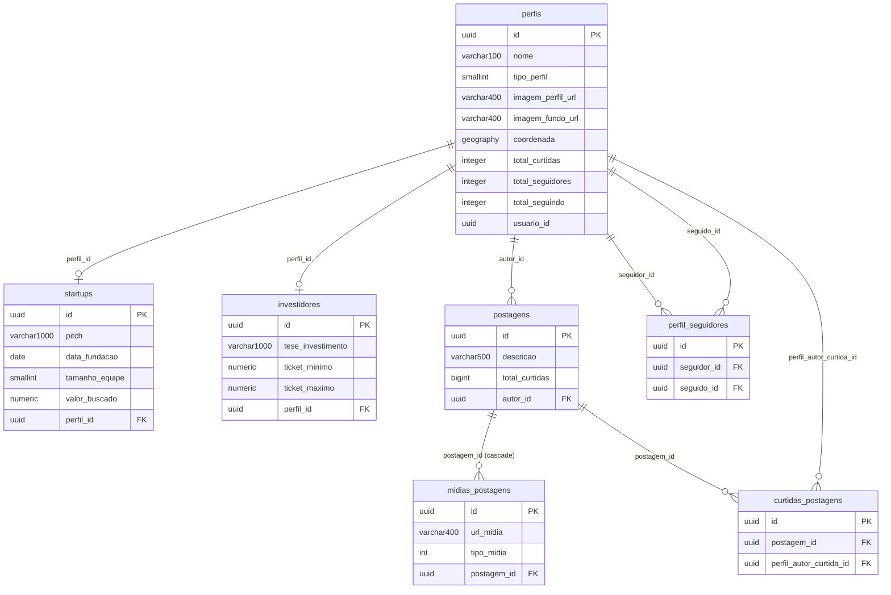

# Banco de dados

[← Índice](README.md)

- **SGBD:** PostgreSQL com a extensão **PostGIS** (o `AppDbContext` declara `HasPostgresExtension("postgis")`, então a migration inicial cria a extensão).
- **ORM:** EF Core 10 com Npgsql e NetTopologySuite.
- **Schema:** `public`. Tabelas e colunas em `snake_case`, nomes de tabela no plural.
- **Mapeamento:** uma classe `IEntityTypeConfiguration` por entidade em `Infrastructure/Persistence/Configurations/`, todas herdando de `BaseConf<T>`.
- **Conexão:** `ConnectionStrings:PostgresConnection`, `CommandTimeout` de 30 s, migrations no assembly `Instartups.Command.Infrastructure`.

Para criar e aplicar migrations, veja [MIGRATE.md](MIGRATE.md).

## Diagrama ER

Todas as tabelas também têm `data_criacao`, `data_atualizacao` e `ativo` (omitidas no diagrama).

## Colunas comuns (`BaseConf<T>`)

| Coluna | Tipo | Nulo | Observação |
| --- | --- | --- | --- |
| `id` | `uuid` | não | PK. Gerado pela aplicação (UUID v7), `ValueGeneratedNever`. |
| `data_criacao` | `timestamptz` | não | Indexada. |
| `data_atualizacao` | `timestamptz` | sim | Indexada. |
| `ativo` | `boolean` | não | Exclusão lógica. |

## Tabelas

### `perfis`

| Coluna | Tipo | Nulo | Observação |
| --- | --- | --- | --- |
| `nome` | `varchar(100)` | não | `NomeVO`. |
| `tipo_perfil` | `smallint` | não | `1` = STARTUP, `2` = INVESTIDOR. |
| `imagem_perfil_url` | `varchar(400)` | sim | |
| `imagem_fundo_url` | `varchar(400)` | sim | |
| `coordenada` | `geography(Point, 4326)` | não | `CoordenadaVO` → `Point(longitude, latitude)` com SRID 4326 (WGS 84). |
| `total_curtidas` | `integer` | não | Contador denormalizado. |
| `total_seguidores` | `integer` | não | Contador denormalizado. |
| `total_seguindo` | `integer` | não | Contador denormalizado. |
| `usuario_id` | `uuid` | não | Id do usuário na `api-instartups-auth`. Sem FK (outro serviço). |

### `startups`

| Coluna | Tipo | Nulo | Observação |
| --- | --- | --- | --- |
| `pitch` | `varchar(1000)` | não | |
| `data_fundacao` | `date` | não | |
| `tamanho_equipe` | `smallint` | não | |
| `valor_buscado` | `numeric(12,2)` | não | |
| `perfil_id` | `uuid` | não | FK → `perfis.id`, único (1:1), `ON DELETE RESTRICT`. |

### `investidores`

| Coluna | Tipo | Nulo | Observação |
| --- | --- | --- | --- |
| `tese_investimento` | `varchar(1000)` | não | |
| `ticket_minimo` | `numeric(12,2)` | não | |
| `ticket_maximo` | `numeric(12,2)` | não | |
| `perfil_id` | `uuid` | não | FK → `perfis.id`, único (1:1), `ON DELETE RESTRICT`. |

### `postagens`

| Coluna | Tipo | Nulo | Observação |
| --- | --- | --- | --- |
| `descricao` | `varchar(500)` | não | |
| `total_curtidas` | `bigint` | não | Contador denormalizado. |
| `autor_id` | `uuid` | não | FK → `perfis.id`, `ON DELETE RESTRICT`. |

### `midias_postagens`

| Coluna | Tipo | Nulo | Observação |
| --- | --- | --- | --- |
| `url_midia` | `varchar(400)` | não | |
| `tipo_midia` | `int` | não | `1` = FOTO, `2` = VIDEO. |
| `postagem_id` | `uuid` | não | FK → `postagens.id`, **`ON DELETE CASCADE`**. |

Mídias removidas de uma postagem são apagadas fisicamente (órfãs da coleção `MidiasPostagem`).

### `curtidas_postagens`

| Coluna | Tipo | Nulo | Observação |
| --- | --- | --- | --- |
| `postagem_id` | `uuid` | não | FK → `postagens.id`, `ON DELETE RESTRICT`. |
| `perfil_autor_curtida_id` | `uuid` | não | FK → `perfis.id` (quem curtiu), `ON DELETE RESTRICT`. |

Índice **único** `(postagem_id, perfil_autor_curtida_id)`: um perfil curte uma postagem no máximo uma vez, mesmo sob concorrência.

### `perfil_seguidores`

| Coluna | Tipo | Nulo | Observação |
| --- | --- | --- | --- |
| `seguidor_id` | `uuid` | não | FK → `perfis.id`, `ON DELETE RESTRICT`. |
| `seguido_id` | `uuid` | não | FK → `perfis.id`, `ON DELETE RESTRICT`. |

Índice **único** `(seguidor_id, seguido_id)`.

## Migrations

Ficam em `Instartups.Command.Infrastructure/Persistence/Migrations/`:

| Migration | Descrição |
| --- | --- |
| `20261011234056_MigrateInicial` | Cria a extensão PostGIS e todas as tabelas, FKs e índices. |
| `20261012020205_AlterandoOnDelete` | Muda a FK `midias_postagens.postagem_id` de `RESTRICT` para `CASCADE`. |
| `20261012030917_AdicionaIndiceUnicoCurtidaPostagem` | Troca o índice simples de `curtidas_postagens.postagem_id` pelo índice único `(postagem_id, perfil_autor_curtida_id)`. |

Os testes de integração aplicam as migrations automaticamente (`Database.MigrateAsync()`) no banco de testes.

## Pontos de atenção

- **Tipos dos contadores:** `TotalVO` é `long`, mas os contadores de `perfis` são `integer`, enquanto `postagens.total_curtidas` é `bigint`, porque `PostagemConfig` não define `HasColumnType`. Não causa problema nos volumes atuais, mas os tipos estão inconsistentes.
- **Concorrência:** os contadores são atualizados em memória (ler → incrementar → salvar), sem token de concorrência. Duas operações simultâneas sobre o mesmo perfil ou postagem podem perder um incremento. Curtidas e seguidores duplicados são barrados pelos índices únicos (o erro do banco, `DbUpdateException`, vira `500`).
- **Sem índice em `perfis.usuario_id`:** quase todo handler busca o perfil por `usuario_id`, e não há índice (nem restrição de unicidade) nessa coluna. A regra "um perfil por usuário" é garantida só pela aplicação.
