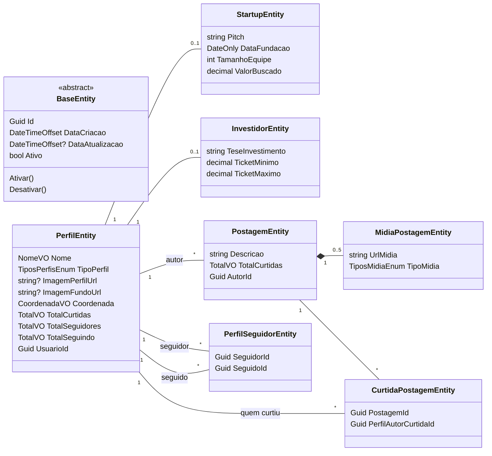
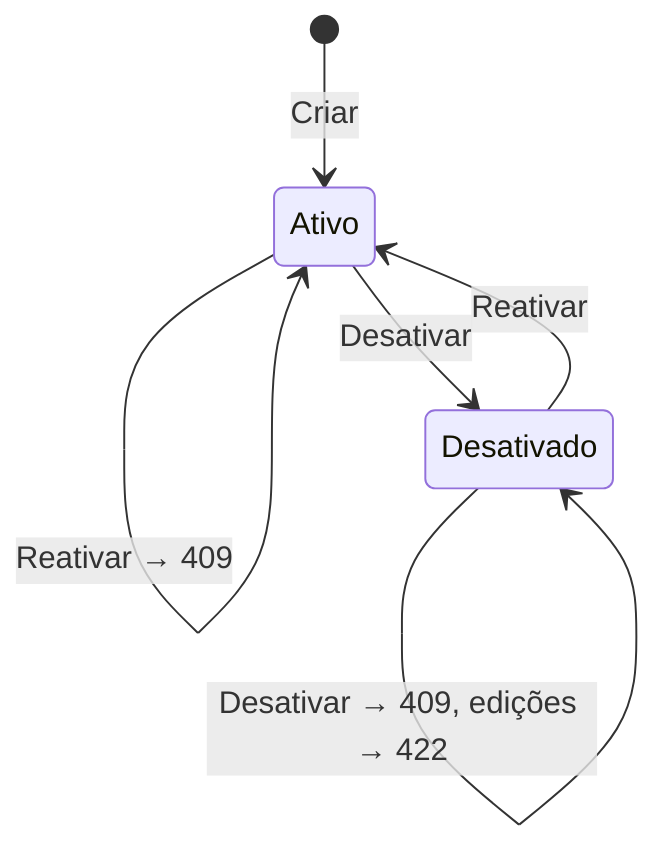

# Domínio

[← Índice](README.md)

O projeto `Instartups.Command.Domain` não depende de nenhum framework. Ele concentra entidades, value objects, enums, domain services, exceções e constantes.

## Modelo

Todas as entidades herdam de `BaseEntity`.

## `BaseEntity`

| Membro | Descrição |
| --- | --- |
| `Id` | `Guid.CreateVersion7()`, gerado na aplicação (ordenável por tempo). O banco não gera ids. |
| `DataCriacao` | UTC, definida na criação. |
| `DataAtualizacao` | UTC, atualizada por `Atualizar()` em toda mutação de domínio; `null` até a primeira alteração. |
| `Ativo` | `true` na criação. Implementa **exclusão lógica**: nada é apagado fisicamente, exceto curtidas, relações de seguir e mídias removidas. |
| `Ativar()` / `Desativar()` | Virtuais; `PerfilEntity` e `PostagemEntity` os sobrescrevem para lançar `409` se o estado já for o desejado. |
| `Equals` / `GetHashCode` | Por `Id`. |

Convenções das entidades: construtor privado sem parâmetros (para o EF), construtor privado completo, *factory method* estático (`Criar…`) e setters privados.

## Entidades

### `PerfilEntity`

Perfil público de um usuário. Cada usuário (`UsuarioId`, vindo do token) tem **no máximo um** perfil, do tipo `STARTUP` ou `INVESTIDOR`, com os dados específicos em `StartupEntity` ou `InvestidorEntity` (1:1).

| Método | Regras |
| --- | --- |
| `CriarStartup(...)` / `CriarInvestidor(...)` | Cria o perfil com contadores zerados e a entidade filha correspondente. |
| `EditarStartup(...)` | Lança `PerfilNaoEhStartupException` (422) se o tipo for outro e `PerfilDesativadoException` (422) se estiver desativado. Substitui nome, coordenada, imagens e dados da startup. |
| `EditarInvestidor(...)` | Mesmo comportamento, para investidor. |
| `EditarCoordenadas(lat, lon)` | Exige perfil ativo. |
| `Desativar()` / `Ativar()` | `PerfilJaDesativadoException` / `PerfilJaAtivoException` (409). |
| `Adicionar/RemoverCurtida(s)`, `Adicionar/RemoverSeguidor`, `Adicionar/RemoverSeguindo` | `internal`: só chamados pelos domain services. |

### `StartupEntity` e `InvestidorEntity`

Dados específicos de cada tipo de perfil. Criadas e editadas apenas por `PerfilEntity` (métodos `internal`).

### `PostagemEntity`

| Membro | Regras |
| --- | --- |
| `Criar(descricao, autorId)` | Começa ativa e com `TotalCurtidas = 0`. |
| `EditarDescricao` | Exige postagem ativa (`PostagemDesativadaException`, 422). |
| `AdicionarMidiaPostagem(url, tipo)` | Exige postagem ativa; **máximo de 5 mídias** (`LimiteMidiasPostagemExcedidoException`, 422). |
| `RemoverMidiaPostagem(id)` | Exige postagem ativa; a mídia precisa pertencer à postagem (`MidiaPostagemNaoEncontradaException`, 404). |
| `Desativar()` / `Ativar()` | `PostagemJaDesativadaException` / `PostagemJaAtivaException` (409). |
| `MidiasPostagem` | Coleção somente leitura; só muda pelos métodos acima. |

### `MidiaPostagemEntity`

URL e tipo (`FOTO`/`VIDEO`) de uma mídia. Pertence à postagem (removida em cascata no banco).

### `CurtidaPostagemEntity`

Registro de que um perfil (`PerfilAutorCurtidaId`) curtiu uma postagem. É removida fisicamente ao descurtir. Há índice único (postagem, perfil).

### `PerfilSeguidorEntity`

Relação "seguidor segue seguido". `Criar(seguidor, seguido)` exige que os dois estejam ativos e sejam diferentes (`PerfilNaoPodeSeguirASiMesmoException`). É removida fisicamente ao deixar de seguir. Há índice único (seguidor, seguido).

## Value objects

| VO | Descrição |
| --- | --- |
| `NomeVO` | Encapsula o nome do perfil e remove espaços nas pontas (`Trim`). Gravado como `varchar(100)`. |
| `CoordenadaVO` | Latitude e longitude. Gravado como `geography(Point, 4326)` (PostGIS). |
| `TotalVO` | Contador (`long`) que nunca fica negativo: `Create` lança `TotalNegativoException` para valores < 0 e `Remover` satura em 0. |

As faixas de latitude/longitude e os tamanhos máximos são validados na Application (FluentValidation), não nos VOs.

## Enums

| Enum | Valores | Persistência |
| --- | --- | --- |
| `TiposPerfisEnum` | `Startup = 1`, `Investidor = 2` | `smallint` |
| `TiposMidiaEnum` | `Foto = 1`, `Video = 2` | `int` |

Em `Enums/Mapear/`:

- `TiposMidiaEnumMap.MapTiposMidia(string)` converte o texto da API (`"foto"`, `" VIDEO "`…) no enum. Valor desconhecido vira `0`, que o validator rejeita com `VALOR_INVALIDO_ENUM`.
- `Map()` converte o enum em texto (`FOTO`, `VÍDEO`, `STARTUP`, `INVESTIDOR`).

## Domain services

Classes estáticas em `Domain/Services/` para regras que envolvem mais de uma entidade. São as únicas que alteram os contadores denormalizados.

### `CurtirPostagemService`

`Curtir(postagem, autorPostagem, perfilQueCurtiu, jaCurtiu)`, verificações em ordem:

1. `jaCurtiu` → `PostagemJaCurtidaException` (409).
2. `autorPostagem` precisa ser o autor da postagem (senão `ArgumentException`, erro de programação).
3. Postagem ativa → senão `PostagemDesativadaException` (422).
4. Autor e quem curte ativos → senão `PerfilDesativadoException` (422).
5. Quem curte ≠ autor → senão `PerfilNaoPodeCurtirPropriaPostagemException` (422).
6. Cria a `CurtidaPostagemEntity` e faz `+1` em `postagem.TotalCurtidas` e `autor.TotalCurtidas`.

`Descurtir(...)` repete as verificações 2 a 4 e faz `−1` nos dois contadores.

### `SeguirPerfilService`

- `Seguir(seguidor, seguido, jaSegue)`: `jaSegue` → `PerfilJaSeguidoException` (409); ambos ativos (422); cria a relação (que valida "não seguir a si mesmo"); `seguidor.TotalSeguindo +1`, `seguido.TotalSeguidores +1`.
- `DeixarDeSeguir(seguidor, seguido)`: ambos ativos (422); `−1` nos mesmos contadores.

### `DesativarPostagemService` / `ReativarPostagemService`

1. Autor ativo → senão `PerfilDesativadoException` (422).
2. Usuário é o autor → senão `PerfilNaoEhAutorPostagemException` (403).
3. `postagem.Desativar()` / `postagem.Ativar()` (409 se já estiver no estado).
4. Ajusta `autor.TotalCurtidas`: **subtrai** as curtidas da postagem ao desativar e **soma** de volta ao reativar.

## Contadores denormalizados

Para que a leitura seja barata, o perfil e a postagem guardam totais que o lado Command mantém sincronizados:

| Contador | Incrementa | Decrementa |
| --- | --- | --- |
| `Perfil.TotalCurtidas` | Alguém curte uma postagem do perfil · reativação de postagem (+ curtidas dela) | Descurtida · desativação de postagem (− curtidas dela) |
| `Perfil.TotalSeguidores` | Alguém segue o perfil | Alguém deixa de seguir |
| `Perfil.TotalSeguindo` | O perfil segue alguém | O perfil deixa de seguir |
| `Postagem.TotalCurtidas` | Curtida | Descurtida |

Ou seja, `Perfil.TotalCurtidas` é a soma das curtidas das postagens **ativas** do perfil.

## Ciclo de vida (ativo/desativado)

O mesmo vale para perfil e postagem. O que um registro desativado bloqueia:

| Estado | Bloqueia |
| --- | --- |
| Perfil desativado | Editar perfil e coordenada; criar, editar, desativar ou reativar postagens; curtir/descurtir (como autor da postagem ou como quem curte); seguir/deixar de seguir (como seguidor ou seguido). |
| Postagem desativada | Editar descrição e mídias; curtir e descurtir. |

## Regras de negócio por caso de uso

| Caso de uso | Pré-condições (erro) | Efeito |
| --- | --- | --- |
| Cadastrar perfil (startup/investidor) | Usuário ainda sem perfil (409) | Cria perfil + startup/investidor. |
| Editar perfil (startup/investidor) | Perfil existe (404), é do tipo certo (422), está ativo (422) | Substitui todos os dados. |
| Editar coordenada | Perfil existe (404) e ativo (422) | Atualiza a coordenada. |
| Desativar / reativar perfil | Perfil existe (404), estado diferente do desejado (409) | Altera `Ativo`. |
| Seguir | Ambos os perfis existem (404); ainda não segue (409); ambos ativos (422); não é o próprio perfil (422) | Cria relação, atualiza contadores. |
| Deixar de seguir | Perfil existe (404); relação existe (404); ambos ativos (422) | Remove relação, atualiza contadores. |
| Cadastrar postagem | Perfil existe (404) e ativo (422); até 5 mídias (422) | Cria postagem e mídias. |
| Editar postagem | Perfil existe e ativo; postagem existe (404); é o autor (403); postagem ativa (422); mídias removidas pertencem à postagem (404); total ≤ 5 (422) | Troca descrição, remove e adiciona mídias. |
| Desativar / reativar postagem | Perfil e postagem existem (404); autor ativo (422); é o autor (403); estado diferente (409) | Altera `Ativo` e ajusta curtidas do autor. |
| Curtir | Perfil e postagem existem (404); ainda não curtiu (409); postagem ativa, perfis ativos, não é o autor (422) | Cria curtida, `+1` nos contadores. |
| Descurtir | Perfil existe (404); curtida existe (404); postagem ativa e perfis ativos (422) | Remove curtida, `−1` nos contadores. |

## Constantes

| Classe | Conteúdo |
| --- | --- |
| `RotasBaseConst` | `api/instartups/command`, `/perfil`, `/postagem`. |
| `TamanhosColunasConst` | Tamanhos máximos e precisão/escala, compartilhados entre validators e mapeamento EF. |
| `CodigosErroConst` / `MensagensErroConst` | Códigos e mensagens de validação e de rate limit. |
| `MensagensSucessoConst` | `Perfil cadastrado com sucesso.`, `Postagem cadastrada com sucesso.` |
| `PermissoesConst` | `Admin`. |
| `OrigensCorsConst` | Nome da política CORS (`FRONTEND`). |
